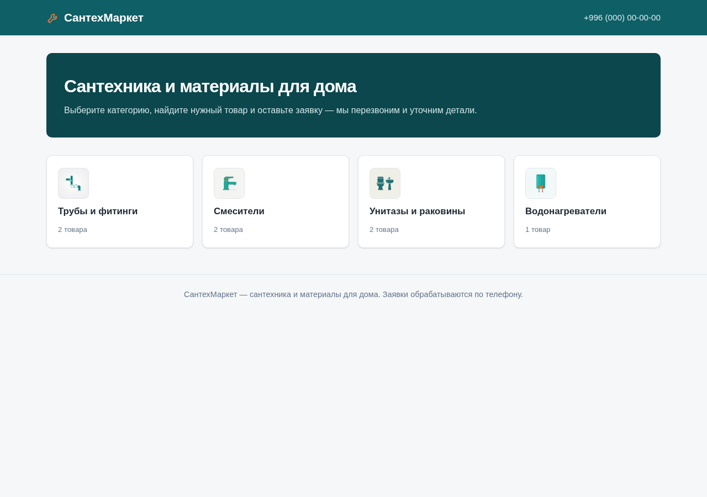
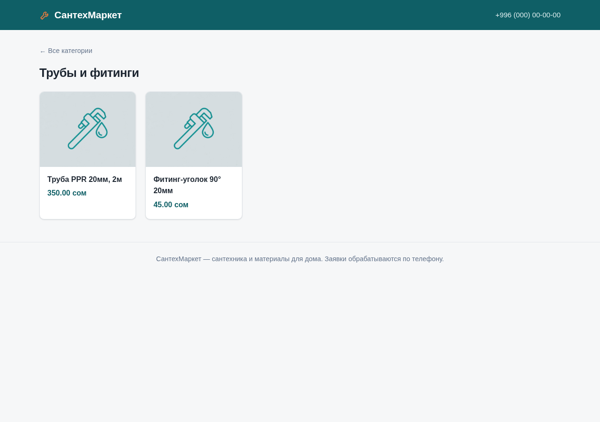

# СантехМаркет

Витрина магазина сантехники на Django: каталог по категориям, корзина в сессии, оформление заказа и админка для владельца магазина.

Проект намеренно простой: серверный рендеринг, SQLite, без JS-фреймворков и внешних тем — всё работает «из коробки» после миграций.

## Возможности

- **Каталог**: главная со списком категорий, страница категории с товарами, карточка товара.
- **Корзина**: добавление с карточки товара и прямо из каталога, изменение количества, удаление, подсчёт итога.
- **Оформление заказа**: имя и телефон с валидацией, создание заказа и позиций, страница подтверждения.
- **Админка**: русские подписи, превью фото товара, цветовой статус остатка (в наличии / мало / нет в наличии), фильтры и поиск, редактирование остатка списком, количество товаров в категории, состав и сумма заказа.
- **Локализация**: интерфейс и админка на русском, цены в сомах, часовой пояс `Asia/Bishkek`.
- **Устойчивость**: некорректное количество не попадает в корзину, удалённые товары вычищаются из сессии, при отсутствии фото показывается заглушка.

## Стек

- Python 3, Django 5.1.15
- Pillow (для `ImageField`)
- SQLite (по умолчанию)
- Django templates

## Быстрый старт

```bash
python -m venv .venv
source .venv/bin/activate
pip install -r requirements.txt
python manage.py migrate
python manage.py createsuperuser
python manage.py runserver
```

Сайт: http://127.0.0.1:8000/ · админка: http://127.0.0.1:8000/admin/

### Демо-данные (необязательно)

```bash
python seed_demo.py
```

Скрипт пересоздаёт категории и товары для быстрого просмотра. ВНИМАНИЕ: он удаляет существующие категории, товары и заказы.

## Тесты

```bash
python manage.py test
```

Сейчас 59 тестов: модели, представления, формы, корзина, оформление заказа, админка, иконки категорий и заглушки изображений. Тесты используют временный каталог для медиа и не пишут в `media/`.

## Структура

```
plumbing-shop/
├── manage.py
├── requirements.txt
├── seed_demo.py           # демо-данные
├── shop/                  # настройки проекта
├── catalog/               # основное приложение
│   ├── models.py          # Category, Product, Order, OrderItem
│   ├── views.py           # домашняя, каталог, товар, корзина, заказ
│   ├── cart.py            # корзина в сессии
│   ├── forms.py           # формы количества и оформления
│   ├── admin.py           # кастомизированная админка
│   ├── templatetags/      # русская плюрализация
│   ├── templates/         # шаблоны
│   ├── static/            # иконки категорий, стили
│   └── tests.py
├── templates/admin/       # брендированный заголовок админки
└── products/              # демо-изображения товаров
```

## Маршруты

| URL | Назначение |
|---|---|
| `/` | Главная, категории |
| `/catalog/<id>/` | Товары категории |
| `/product/<id>/` | Карточка товара |
| `/cart/` | Корзина и оформление заказа |
| `/cart/add/<id>/` | Добавить товар (POST) |
| `/cart/update/<id>/` | Изменить количество (POST) |
| `/cart/remove/<id>/` | Удалить товар (POST) |
| `/order-thanks/<id>/` | Подтверждение заказа |
| `/admin/` | Админка |

## Скриншоты

| Главная | Каталог |
|---|---|
|  |  |

## Замечания

- `db.sqlite3`, `media/`, `.venv/` и логи исключены из репозитория через `.gitignore`.
- `DEBUG = True` и `SECRET_KEY` в `settings.py` рассчитаны на локальную разработку. Для продакшена нужны отдельные настройки, реальный секретный ключ и `collectstatic`.
- Медиа раздаются только при `DEBUG = True` (см. `shop/urls.py`).
